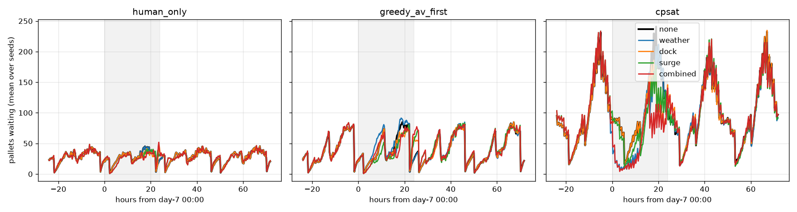

# Dallas–Houston autonomous LTL lane digital twin

**Status: in progress.** The simulator, the calibrated scenarios, the baselines, the CP-SAT dispatcher with ablations and controls, and the disruption study are done. Sensitivity sweeps (AV fleet and hours, AV cost, demand) and the final polish come next.

This is a SimPy discrete-event model of an LTL network around one autonomous linehaul lane (Dallas ↔ Houston terminals plus 3P endpoints). It is used to compare policies for deciding which consolidated freight rides an AV truck and which rides a human-driven one. All parameters are explicit assumptions in `ltltwin/config.py`, not Waabi, Volvo or Warp figures. The context is the [Volvo × Waabi customer operations with Warp on Dallas–Houston](https://waabi.ai/insights/volvo-and-waabi-kick-off-customer-operations-in-texas-starting-with-warp) (Oct 5, 2026).

## Layout
- `ltltwin/config.py`: every assumption (network, docks, AV hours and fleet, costs, demand profile, SLAs, disruptions).
- `ltltwin/sim.py`: shipments → inbound dock (door contention) → pool → linehaul (AV or human, direct-to-3P allowed) → destination dock or final mile.
- `ltltwin/scenarios.py`: balanced and imbalanced demand.
- `ltltwin/optimizer.py`: CP-SAT rolling-horizon dispatcher.
- `experiments/`: calibrate, run_grid (resumable and parallel), summarize.
- `ltltwin/policies.py`: `HumanOnly`, `AVFixed` (fixed headway), `GreedyAVFirst` (fill threshold plus empty repositioning).
- `ltltwin/kpi.py`: on-time %, dwell, trailer fill, AV utilization and share, cost per pallet (with and without late penalty).
- `tests/`: conservation, trailer capacity, AV operating window and weather hold, determinism, and that AV fleet = 0 reduces to human-only.

## Assumptions (all in `ltltwin/config.py`; none are Waabi, Volvo or Warp figures)
| Area | Parameter | Default | Basis / note | Swept? |
|---|---|---|---|---|
| Network | terminals / 3P endpoints | DAL, HOU; 2 endpoints per metro | Simplified hub pair plus customer docks | — |
| | lane distance | 240 mi (+20 mi to an endpoint) | I-45 Dallas–Houston, approximate | — |
| | speed (human / AV) | 58 / 55 mph door-to-door | AV assumed to run a slightly more conservative speed policy | — |
| | human driver limit | 11 h | US HOS drive limit; the model checks that a one-way run fits (no relays) | — |
| Docks | doors per terminal | 6 | Linehaul-usable doors | dock outage |
| | load / unload | 2.5 / 2.0 min per pallet | Typical forklift rates | — |
| Equipment | trailer | 26 pallet positions | 53' dry van, single-stacked | — |
| | AV fleet | 2 tractors | Early-operations scale | 0–6 |
| | AV departure window | 05:00–21:00 | Assumed operating design domain; observer on board | 12 h, 24 h |
| | AV direct-to-3P | allowed | Mirrors "direct to third-party facilities" in the Oct 2026 release | ablation |
| Cost | human linehaul | $2.30/mi + $150 per dispatch | Plausible US truckload driver and equipment cost plus a call-out minimum | — |
| | AV linehaul | $1.60/mi | Includes amortized observer and remote-ops overhead; the most uncertain number here | 1.2–2.3 |
| | late penalty (reporting) | $75 per late shipment | Service-failure charge, used only in "cost+late" | — |
| | CP-SAT objective | late $300 + $50/h; holding $0.50 per pallet-h; buffer 30 min | Optimizer weights, not costs | floor, buffer, late weight |
| Demand | volume | 200 shipments/day (balanced 100/100; imbalanced 140/60) | Synthetic; about 700 pallets/day | ±30% |
| | size | 1–6 pallets, uniform | LTL range | — |
| | ready-time profile | afternoon/evening peak after P&D sweeps | Hourly weights in config | — |
| | consignee | 35% to a 3P endpoint, else terminal | Assumption | — |
| | deadline | ready + U[12, 28] h | Calibrated so human-only is about 92.5% on-time (seeds 1000–1004) | calibration sweep |
| Baselines | human sweep departures | 22:00 and 02:00 | Night linehaul pattern | — |
| Sim | horizon / warm-up | 14 days (+3 drain) / 2 days | KPIs cover freight created on days 2–14 | — |
| | decision tick | 15 min (CP-SAT re-plans every 60 min) | | re-plan 30/120 min |

## Calibration
The deadline window was swept for the human-only baseline (5 seeds per point, seeds 1000–1004, disjoint from the evaluation seeds 0–29; `experiments/calibrate.py` → `results/calibration_sla.json`). A window of `ready + U[12, 28] h` puts human-only at about 92.5% on-time, which leaves room for policies to differ. Windows of 18–30 h (the original default) gave 98.5%, and 8–20 h gave 79.8%.

## Scenarios
Both scenarios have 200 shipments/day in total (`ltltwin/scenarios.py`):
- `balanced`: 100/day each way.
- `imbalanced`: 140/day DAL→HOU (head-haul) and 60/day HOU→DAL (back-haul), an assumed 7:3 split.

## Baseline results (30 seeds per cell, common random numbers, mean ± 95% t-CI)
Generated by `experiments/summarize.py` from `results/grid_baselines.csv`. The full tables, including trailer fill, AV utilization and human trips, are in `results/summary.md`.

| Scenario | Policy | On-time | Cost/pallet $ | Dwell h | AV pallet share |
|---|---|---|---|---|---|
| balanced | human_only | 0.926 ± 0.002 | 33.81 ± 0.16 | 1.79 | 0 |
| balanced | av_fixed (4 h headway) | 0.913 ± 0.002 | 32.60 ± 0.19 | 2.36 | 0.075 |
| balanced | greedy_av_first | 0.919 ± 0.003 | 30.57 ± 0.19 | 2.23 | 0.173 |
| imbalanced | human_only | 0.924 ± 0.002 | 33.69 ± 0.18 | 1.77 | 0 |
| imbalanced | av_fixed | 0.915 ± 0.002 | 32.68 ± 0.20 | 2.31 | 0.076 |
| imbalanced | greedy_av_first | 0.920 ± 0.002 | 31.11 ± 0.20 | 2.16 | 0.155 |

Paired differences vs human-only (same seeds, so same demand): greedy AV-first is −$3.24 ± 0.12 per pallet and −0.68 ± 0.13 pp on-time (balanced), and −$2.58 ± 0.13 and −0.39 ± 0.15 pp (imbalanced). The AV saves money but trades a little service, because freight waits to fill AV trailers. The imbalance cuts the AV's savings, since the back-haul fills more slowly.

## CP-SAT dispatcher (`ltltwin/optimizer.py`)
This is a rolling-horizon assignment model. Each pooled shipment goes to an AV slot (one per AV per horizon), an hourly human slot or **defer**. The objective is:
- linehaul cost;
- lateness cost (a fixed charge once late plus a per-hour charge, with the same 30-minute safety buffer as the baselines' at-risk rule);
- a small waiting cost;
- for deferred freight, **a floor on its future cost**: its pallets × a per-pallet rate, plus the lateness it would incur leaving at the horizon end. The per-pallet rate is a capacity-weighted blend of the AV and human full-trailer rates, where the AV weight is the AV capacity actually available in the horizon divided by the pallets waiting (human rate if no AV slot).

Only "now" slots are executed. If the solver fails, it falls back to greedy for that epoch. CP-SAT runs single-threaded with a 1.0 s limit per solve. Waiting is charged per pallet-hour ($0.50).

Review history (PR #1):
- The first version let deferral past the horizon be free of truck cost. The solver could push freight out almost for nothing, so its cost advantage could be an objective artifact. Deferral is now charged as described above, and `tests/test_optimizer.py::test_deferral_is_not_free` and `::test_full_trailer_ships_within_horizon_rather_than_deferring` guard it.
- Round 2: the floor priced all deferred freight at the AV rate even when no AV slot was free, which biased the solver toward holding freight. It is now the capacity-weighted marginal rate above, and a floor sweep shows the cost result doesn't depend on it. Wait cost moved to per pallet-hour, so full-trailer tests pass by more than $100 rather than $2. Tests run from any working directory.
- CP-SAT results from before each fix were discarded and re-run.

### Results (objective after both PR #1 review rounds; paired with the same seeds; generated in `results/summary.md`)
| Scenario | Policy (seeds) | On-time | Cost/pallet $ | Cost+late/pallet $ | Dwell h | Human fill | Human trips | AV pallet share |
|---|---|---|---|---|---|---|---|---|
| balanced | human_only (30) | 0.926 ± 0.002 | 33.81 ± 0.16 | 35.17 ± 0.18 | 1.79 | 0.802 | 402 | 0 |
| balanced | greedy_av_first (30) | 0.919 ± 0.003 | 30.57 ± 0.19 | 32.06 ± 0.22 | 2.23 | 0.816 | 327 | 0.173 |
| balanced | **cpsat** (10) | 0.904 ± 0.003 | **24.91 ± 0.18** | **26.69 ± 0.15** | 4.76 | 0.981 | 257 | 0.217 |
| balanced | cpsat, **no AVs** (5) | 0.933 ± 0.005 | 32.69 ± 0.48 | 33.92 ± 0.38 | 2.53 | 0.826 | 388 | 0 |
| imbalanced | human_only (30) | 0.924 ± 0.002 | 33.69 ± 0.18 | 35.09 ± 0.20 | 1.77 | 0.803 | 401 | 0 |
| imbalanced | greedy_av_first (30) | 0.920 ± 0.002 | 31.11 ± 0.20 | 32.58 ± 0.21 | 2.16 | 0.813 | 334 | 0.155 |
| imbalanced | **cpsat** (10) | 0.882 ± 0.006 | **25.38 ± 0.38** | **27.54 ± 0.31** | 5.11 | 0.970 | 264 | 0.209 |

Paired differences:

| Scenario | Comparison | Δ on-time (pp) | Δ cost/pallet $ | Δ dwell h |
|---|---|---|---|---|
| balanced | cpsat − human_only | −2.25 ± 0.28 | −8.81 ± 0.30 | +2.97 ± 0.09 |
| balanced | cpsat − greedy_av_first | −1.43 ± 0.18 | −5.69 ± 0.44 | +2.54 ± 0.10 |
| balanced | cpsat (no AVs) − human_only | +0.63 ± 0.48 | −1.07 ± 0.36 | +0.75 ± 0.17 |
| imbalanced | cpsat − human_only | −3.69 ± 0.40 | −8.46 ± 0.36 | +3.35 ± 0.13 |
| imbalanced | cpsat − greedy_av_first | −3.32 ± 0.45 | −5.77 ± 0.39 | +2.96 ± 0.13 |

### Defer-floor sensitivity (balanced, seeds 0–4, paired vs human_only)
| Defer floor | Δ cost/pallet $ | Δ on-time (pp) | Δ dwell h |
|---|---|---|---|
| ×0.5 marginal | −8.84 ± 0.68 | −1.31 ± 0.53 | +4.43 |
| **marginal (default)** | −8.81 ± 0.30 (10 seeds) | −2.25 ± 0.28 | +2.97 |
| ×1.5 marginal | −8.69 ± 0.72 | −2.03 ± 0.54 | +2.05 |
| always human rate | −8.80 ± 0.69 | −1.95 ± 0.31 | +2.14 |
| always AV rate | −9.06 ± 0.67 | −1.54 ± 0.47 | +4.40 |

### Ablations (balanced, 5 seeds, paired vs human_only)
| Variant | Δ cost/pallet $ | Δ on-time (pp) | Δ dwell h | Note |
|---|---|---|---|---|
| myopic (horizon 0: ship now or defer) | −8.07 ± 0.52 | −2.53 ± 0.73 | +1.27 | AV share falls 0.22 → 0.15 |
| horizon 4 h | −8.05 ± 0.58 | −2.23 ± 0.46 | +2.91 | |
| horizon 8 h (default) | −8.81 ± 0.30 | −2.25 ± 0.28 | +2.97 | 10 seeds |
| horizon 12 h | −8.71 ± 0.63 | −2.01 ± 0.61 | +2.05 | |
| warm start | −8.94 ± 0.66 | −2.63 ± 0.55 | +3.01 | time-limited solves 0.1% vs 0.4% |
| no direct-to-3P | −8.89 ± 0.73 | −2.39 ± 0.43 | +2.98 | same as default within noise |
| no empty repositioning | −8.88 ± 0.73 | −2.38 ± 0.43 | +2.99 | same as default within noise |

Known limitation of the floor (issue #2): `av_share` counts AV capacity *inside* the planning window, which in-window AV slots can already use. So it partly double-counts that capacity as an outlet for deferred freight, and the floor is a heuristic, not an exact continuation value. The sweep above bounds the effect: cost is insensitive to it, dwell is not.

What this means:
- **The cost result is robust to the objective's defer floor.** Scaling the floor from ×0.5 to the full human rate moves cost by under $0.40 per pallet. What the floor really controls is the dwell vs on-time trade: a cheaper floor gives longer holds and *better* on-time (the solver waits for AV slots), while a pricier floor gives shorter holds.
- **Dispatching alone isn't the source of the saving; AVs are what make consolidation pay.** The same CP-SAT dispatcher without AVs saves only $1.07 per pallet over human-only, at +0.6 pp on-time. With AVs it saves $8.81, so about 88% of the optimizer's saving depends on AV capacity. With AVs as an outlet for the residual partial loads, human trucks run nearly full (fill 0.98 vs 0.83). The greedy heuristic captures only $3.24 of that value.
- **The optimizer pays for this in service:** −2.3 pp on-time balanced and −3.7 pp imbalanced, plus about 3 h more dwell. The imbalanced lane hurts more because back-haul freight waits to fill. The cost/service trade is a business choice. Including a $75/late-shipment charge, CP-SAT is still the cheapest ($26.69 vs $35.17).
- **Planning horizon:** looking ahead matters most for AV use. Horizon 0 drops the AV share to 0.15 and costs about $0.75 per pallet more than 8–12 h.
- **Inert features:** direct-to-3P delivery and empty repositioning never trigger under CP-SAT in this setting, because consolidated mixed trailers are never single-endpoint loads. They matter only for the greedy baseline.
- **Solver health:** 13,505 default solves; 0.4% hit the 1.0 s limit; 0 fallbacks. Warm-starting cuts that to 0.1% without changing KPIs, so it's left off by default.

## Disruption case study (`experiments/disruptions.py`; balanced, 8 seeds, paired vs the same seed undisturbed)
Day-7 events:
- **weather:** AV hold 04:00–16:00;
- **dock:** Dallas loses 4 of 6 doors 15:00–23:00;
- **surge:** 50% of day-7 pickups slip 2–6 h;
- **combined:** all three.

Metrics cover freight created on days 7–8.

| Case | Policy | Window on-time | Δ vs undisturbed (pp) | Peak excess backlog (pallets) | Excess pallet-hours |
|---|---|---|---|---|---|
| weather | human_only | 0.930 | 0.00 (no AV) | 0 | 0 |
| weather | greedy_av_first | 0.914 | −0.30 ± 0.65 | 53 ± 10 | 292 ± 63 |
| weather | cpsat | 0.917 | +1.25 ± 0.89 | 38 ± 15 | 448 ± 186 |
| dock | human_only | 0.930 | −0.03 ± 0.08 | 35 ± 7 | 55 ± 15 |
| dock | greedy_av_first | 0.917 | −0.00 ± 0.27 | 50 ± 14 | 120 ± 45 |
| dock | cpsat | 0.904 | −0.10 ± 0.29 | 44 ± 16 | 262 ± 190 |
| surge | human_only | 0.900 | −3.02 ± 1.66 | 50 ± 3 | 602 ± 74 |
| surge | greedy_av_first | 0.895 | −2.14 ± 1.74 | 68 ± 12 | 782 ± 190 |
| surge | cpsat | 0.882 | −2.27 ± 2.33 | 87 ± 14 | 1109 ± 468 |
| combined | human_only | 0.899 | −3.12 ± 1.65 | 52 ± 6 | 592 ± 70 |
| combined | greedy_av_first | 0.890 | −2.66 ± 1.56 | 77 ± 13 | 876 ± 182 |
| combined | cpsat | 0.884 | −2.02 ± 2.00 | 94 ± 12 | 1097 ± 395 |



Narrative:
- **The plot shows each policy's operating style.** CP-SAT runs a large standing backlog every day (peaks of 150–230 pallets vs about 30–50 for human-only). This is the consolidation strategy that drives both its cost advantage and its extra dwell; disruptions are small on top of it.
- **A 12 h AV weather hold barely hurts service under either AV policy.** Human trucks absorb the freight. Under CP-SAT, window on-time even rises (+1.25 ± 0.89 pp, a CI that only just excludes zero) because frozen AV slots force earlier human departures. The cost is a backlog that peaks at 40–50 pallets.
- **A dock outage at the inbound peak is close to free for on-time** for every policy (|Δ| ≤ 0.1 pp), but it adds backlog.
- **The late-pickup surge dominates.** It costs 2–3 pp on-time for every policy, and the CIs overlap, so no policy is clearly more resilient on service. CP-SAT carries the largest excess backlog (about 1,100 pallet-hours vs about 600 for human-only), because it was already holding freight to consolidate. A consolidation-heavy optimizer has less slack to absorb surges.
- With 8 seeds, the disruption Δ CIs are wide (±1–2 pp). More seeds are on the to-do list.

## Reproduce
```bash
uv venv .venv && uv pip install --python .venv/bin/python -r requirements.txt   # pinned
.venv/bin/python -m pytest -q tests                            # 20 tests
WORKERS=4 ./run_all.sh                                        # resumable grids -> results/grid_*.csv
.venv/bin/python experiments/summarize.py                     # -> results/summary.md
```
