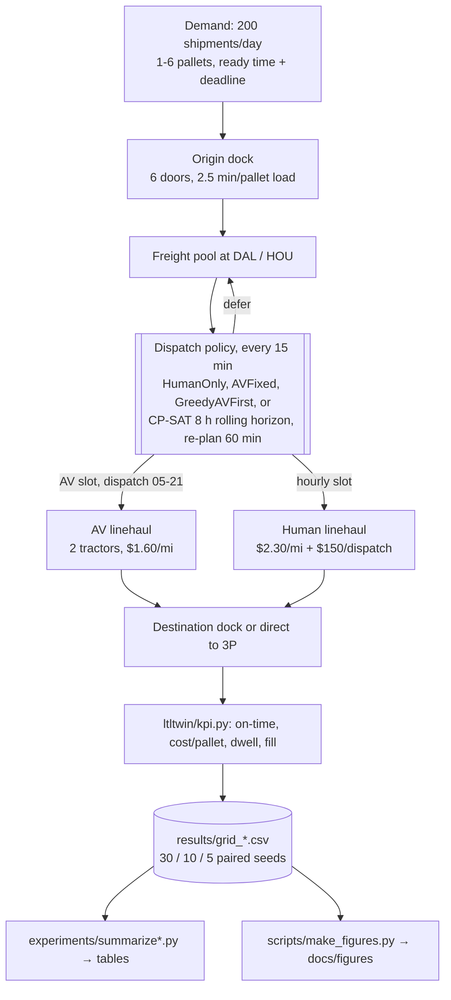
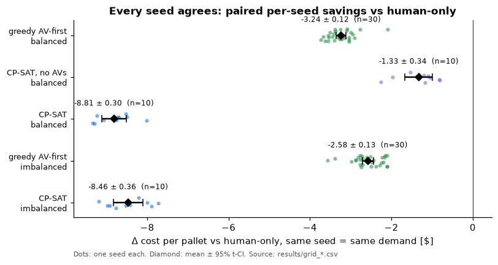
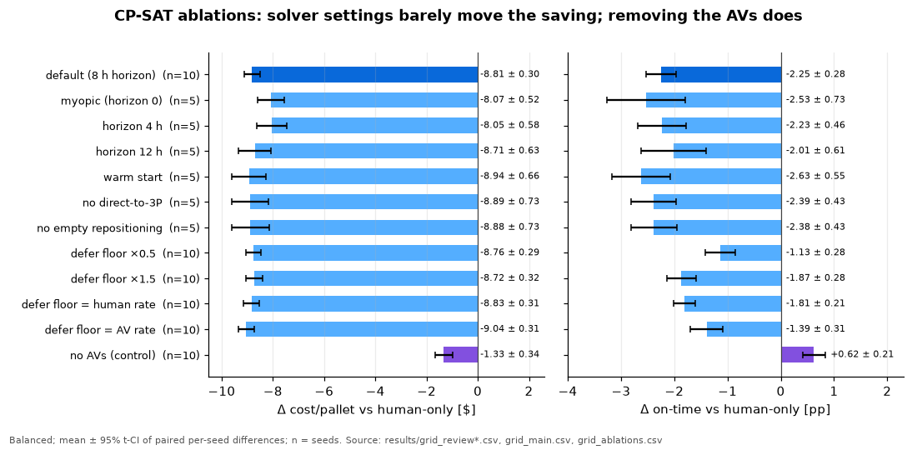

# Dallas–Houston autonomous LTL lane digital twin

**Status: in progress.** The simulator, the calibrated scenarios, the baselines, the CP-SAT dispatcher with ablations and controls, and the disruption study are done. Sensitivity sweeps, the seed-stability check and the assumptions table are done (PR #3).

This is a SimPy discrete-event model of an LTL network around one autonomous linehaul lane (Dallas ↔ Houston terminals plus 3P endpoints). It is used to compare policies for deciding which consolidated freight rides an AV truck and which rides a human-driven one. All parameters are explicit assumptions in `ltltwin/config.py`, not Waabi, Volvo or Warp figures. The context is the [Volvo × Waabi customer operations with Warp on Dallas–Houston](https://waabi.ai/insights/volvo-and-waabi-kick-off-customer-operations-in-texas-starting-with-warp) (Oct 5, 2026).

## At a glance
| | |
|---|---|
| **What** | SimPy discrete-event twin of one autonomous LTL linehaul lane (Dallas ↔ Houston + 3P endpoints), comparing human-only, fixed-headway AV, greedy AV-first and a CP-SAT rolling-horizon dispatcher |
| **Headline** | CP-SAT with 2 AVs: **−$8.81 ± 0.30 per pallet** vs human-only, at **−2.25 ± 0.28 pp on-time** and +2.97 h dwell (balanced, 10 paired seeds) |
| **Why** | Same CP-SAT without AVs saves only $1.33 ± 0.34, so about 85% of the saving depends on AV capacity |
| **Baseline** | Greedy AV-first: −$3.24 ± 0.12 per pallet, −0.68 ± 0.13 pp on-time (30 seeds) |
| **Surprise** | Opening AVs to 24 h is **$0.71 ± 0.48 per pallet worse** than 05–21 (paired, 10 seeds): the window acts as an AV timetable the planner can't find itself |
| **Robustness** | Still saves $7.25 per pallet at AV/human per-mile parity; defer-floor sweep moves cost by < $0.40 |
| **Rigor** | Common random numbers, 95% t-CIs on paired per-seed differences, 45 tests (conservation, capacity, AV window, determinism, config validation) |

All parameters are synthetic assumptions (table below); the policy ranking is the result, not the dollar levels.



### What a simulated schedule looks like


One simulated run (balanced demand, seed 0), read from `results/schedule_balanced_seed0.csv`, which `experiments/export_schedule.py` writes. The seed-0 KPIs from that export match the committed grid rows (greedy on-time 0.9163, $29.63 per pallet; CP-SAT 0.8995, $25.06). CP-SAT holds freight to send fewer, fuller human trucks, and both AV tractors run near-full trailers inside the dispatch window.

### Results in four plots


**Cost vs service per policy.** CP-SAT is cheapest but loses some on-time. Without AVs, the same dispatcher lands next to human-only.

<p>


</p>

**Left:** paired per-seed savings (one dot per seed, same demand for every policy). **Right:** CP-SAT ablations. Horizon, warm start and defer floor barely move the saving; removing the AVs removes most of it.


**Sensitivity sweeps** (5 seeds each, paired vs human-only under the same setting). Each extra AV is worth less than the one before. CP-SAT still saves at per-mile parity because the AV has no per-dispatch fee in this model, which is the main open sensitivity.

Figures are drawn by `scripts/make_figures.py` from the committed `results/grid_*.csv` and `results/schedule_balanced_seed0.csv`. It uses the same t-CI formula as `experiments/summarize.py`, so plotted values match the tables below.

## Layout
- `ltltwin/config.py`: every assumption (network, docks, AV hours and fleet, costs, demand profile, SLAs, disruptions).
- `ltltwin/sim.py`: shipments → inbound dock (door contention) → pool → linehaul (AV or human, direct-to-3P allowed) → destination dock or final mile.
- `ltltwin/scenarios.py`: balanced and imbalanced demand.
- `ltltwin/optimizer.py`: CP-SAT rolling-horizon dispatcher.
- `experiments/`: calibrate, run_grid (resumable and parallel), summarize.
- `ltltwin/policies.py`: `HumanOnly`, `AVFixed` (fixed headway), `GreedyAVFirst` (fill threshold plus empty repositioning).
- `ltltwin/kpi.py`: on-time %, dwell, trailer fill, AV utilization and share, cost per pallet (with and without late penalty).
- `tests/`: conservation, trailer capacity, AV operating window and weather hold, determinism, and that AV fleet = 0 reduces to human-only; config validation (bad AV hours, oversized shipments, tick_min <= 0, …) and overnight AV windows.

## Assumptions (all in `ltltwin/config.py`; none are Waabi, Volvo or Warp figures)
| Area | Parameter | Default | Basis / note | Swept? |
|---|---|---|---|---|
| Network | terminals / 3P endpoints | DAL, HOU; 2 endpoints per metro | Simplified hub pair plus customer docks | — |
| | lane distance | 240 mi (+20 mi to an endpoint) | I-45 Dallas–Houston, approximate | — |
| | speed (human / AV) | 58 / 55 mph door-to-door | AV assumed to run a slightly more conservative speed policy | — |
| | human driver limit | 11 h | US HOS drive limit; the model checks that a one-way run fits (no relays) | — |
| Docks | doors per terminal | 6 | Linehaul-usable doors | dock outage |
| | load / unload | 2.5 / 2.0 min per pallet | Typical forklift rates | — |
| Equipment | trailer | 26 pallet positions | 53' dry van, single-stacked | — |
| | AV fleet | 2 tractors | Early-operations scale | 0–6 |
| | AV departure window | 05:00–21:00 | Assumed operating design domain; observer on board | 12 h, 24 h |
| | AV direct-to-3P | allowed | Mirrors "direct to third-party facilities" in the Oct 2026 release | ablation |
| Cost | human linehaul | $2.30/mi + $150 per dispatch | Plausible US truckload driver and equipment cost plus a call-out minimum | — |
| | AV linehaul | $1.60/mi | Includes amortized observer and remote-ops overhead; the most uncertain number here | 1.2–2.3 |
| | late penalty (reporting) | $75 per late shipment | Service-failure charge, used only in "cost+late" | — |
| | CP-SAT objective | late $300 + $50/h; holding $0.50 per pallet-h; buffer 30 min | Optimizer weights, not costs | floor, buffer, late weight |
| Demand | volume | 200 shipments/day (balanced 100/100; imbalanced 140/60) | Synthetic; about 700 pallets/day | ±30% |
| | size | 1–6 pallets, uniform | LTL range | — |
| | ready-time profile | afternoon/evening peak after P&D sweeps | Hourly weights in config | — |
| | consignee | 35% to a 3P endpoint, else terminal | Assumption | — |
| | deadline | ready + U[12, 28] h | Calibrated so human-only is about 92.5% on-time (seeds 1000–1004) | calibration sweep |
| Baselines | human sweep departures | 22:00 and 02:00 | Night linehaul pattern | — |
| Sim | horizon / warm-up | 14 days (+3 drain) / 2 days | KPIs cover freight created on days 2–14 | — |
| | decision tick | 15 min (CP-SAT re-plans every 60 min) | | re-plan 30/120 min |

## Calibration
The deadline window was swept for the human-only baseline (5 seeds per point, seeds 1000–1004, disjoint from the evaluation seeds 0–29; `experiments/calibrate.py` → `results/calibration_sla.json`). A window of `ready + U[12, 28] h` puts human-only at about 92.5% on-time, which leaves room for policies to differ. Windows of 18–30 h (the original default) gave 98.5%, and 8–20 h gave 79.8%.

## Scenarios
Both scenarios have 200 shipments/day in total (`ltltwin/scenarios.py`):
- `balanced`: 100/day each way.
- `imbalanced`: 140/day DAL→HOU (head-haul) and 60/day HOU→DAL (back-haul), an assumed 7:3 split.

## Baseline results (30 seeds per cell, common random numbers, mean ± 95% t-CI)
Generated by `experiments/summarize.py` from `results/grid_baselines.csv`. The full tables, including trailer fill, AV utilization and human trips, are in `results/summary.md`.

| Scenario | Policy | On-time | Cost/pallet $ | Dwell h | AV pallet share |
|---|---|---|---|---|---|
| balanced | human_only | 0.926 ± 0.002 | 33.81 ± 0.16 | 1.79 | 0 |
| balanced | av_fixed (4 h headway) | 0.913 ± 0.002 | 32.60 ± 0.19 | 2.36 | 0.075 |
| balanced | greedy_av_first | 0.919 ± 0.003 | 30.57 ± 0.19 | 2.23 | 0.173 |
| imbalanced | human_only | 0.924 ± 0.002 | 33.69 ± 0.18 | 1.77 | 0 |
| imbalanced | av_fixed | 0.915 ± 0.002 | 32.68 ± 0.20 | 2.31 | 0.076 |
| imbalanced | greedy_av_first | 0.920 ± 0.002 | 31.11 ± 0.20 | 2.16 | 0.155 |

Paired differences vs human-only (same seeds, so same demand): greedy AV-first is −$3.24 ± 0.12 per pallet and −0.68 ± 0.13 pp on-time (balanced), and −$2.58 ± 0.13 and −0.39 ± 0.15 pp (imbalanced). The AV saves money but trades a little service, because freight waits to fill AV trailers. The imbalance cuts the AV's savings, since the back-haul fills more slowly.

## CP-SAT dispatcher (`ltltwin/optimizer.py`)
This is a rolling-horizon assignment model. Each pooled shipment goes to an AV slot (one per AV per horizon), an hourly human slot or **defer**. The objective is:
- linehaul cost;
- lateness cost (a fixed charge once late plus a per-hour charge, with the same 30-minute safety buffer as the baselines' at-risk rule);
- a small waiting cost;
- for deferred freight, **a floor on its future cost**: its pallets × a per-pallet rate, plus the lateness it would incur leaving at the horizon end. The per-pallet rate is a capacity-weighted blend of the AV and human full-trailer rates, where the AV weight is the AV capacity actually available in the horizon divided by the pallets waiting (human rate if no AV slot).

Only "now" slots are executed. If the solver fails, it falls back to greedy for that epoch. CP-SAT runs single-threaded with a 1.0 s limit per solve. Waiting is charged per pallet-hour ($0.50).

Review history (PR #1):
- The first version let deferral past the horizon be free of truck cost. The solver could push freight out almost for nothing, so its cost advantage could be an objective artifact. Deferral is now charged as described above, and `tests/test_optimizer.py::test_deferral_is_not_free` and `::test_full_trailer_ships_within_horizon_rather_than_deferring` guard it.
- Round 2: the floor priced all deferred freight at the AV rate even when no AV slot was free, which biased the solver toward holding freight. It is now the capacity-weighted marginal rate above, and a floor sweep shows the cost result doesn't depend on it. Wait cost moved to per pallet-hour, so full-trailer tests pass by more than $100 rather than $2. Tests run from any working directory.
- CP-SAT results from before each fix were discarded and re-run.

### Results (objective after both PR #1 review rounds; paired with the same seeds; generated in `results/summary.md`)
| Scenario | Policy (seeds) | On-time | Cost/pallet $ | Cost+late/pallet $ | Dwell h | Human fill | Human trips | AV pallet share |
|---|---|---|---|---|---|---|---|---|
| balanced | human_only (30) | 0.926 ± 0.002 | 33.81 ± 0.16 | 35.17 ± 0.18 | 1.79 | 0.802 | 402 | 0 |
| balanced | greedy_av_first (30) | 0.919 ± 0.003 | 30.57 ± 0.19 | 32.06 ± 0.22 | 2.23 | 0.816 | 327 | 0.173 |
| balanced | **cpsat** (10) | 0.904 ± 0.003 | **24.91 ± 0.18** | **26.69 ± 0.15** | 4.76 | 0.981 | 257 | 0.217 |
| balanced | cpsat, **no AVs** (10) | 0.932 ± 0.003 | 32.40 ± 0.30 | 33.65 ± 0.28 | 2.57 | 0.834 | 386 | 0 |
| imbalanced | human_only (30) | 0.924 ± 0.002 | 33.69 ± 0.18 | 35.09 ± 0.20 | 1.77 | 0.803 | 401 | 0 |
| imbalanced | greedy_av_first (30) | 0.920 ± 0.002 | 31.11 ± 0.20 | 32.58 ± 0.21 | 2.16 | 0.813 | 334 | 0.155 |
| imbalanced | **cpsat** (10) | 0.882 ± 0.006 | **25.38 ± 0.38** | **27.54 ± 0.31** | 5.11 | 0.970 | 264 | 0.209 |

Paired differences:

| Scenario | Comparison | Δ on-time (pp) | Δ cost/pallet $ | Δ dwell h |
|---|---|---|---|---|
| balanced | cpsat − human_only | −2.25 ± 0.28 | −8.81 ± 0.30 | +2.97 ± 0.09 |
| balanced | cpsat − greedy_av_first | −1.43 ± 0.18 | −5.69 ± 0.44 | +2.54 ± 0.10 |
| balanced | cpsat (no AVs) − human_only | +0.62 ± 0.21 | −1.33 ± 0.34 | +0.78 ± 0.07 |
| imbalanced | cpsat − human_only | −3.69 ± 0.40 | −8.46 ± 0.36 | +3.35 ± 0.13 |
| imbalanced | cpsat − greedy_av_first | −3.32 ± 0.45 | −5.77 ± 0.39 | +2.96 ± 0.13 |

### Defer-floor sensitivity (balanced, 10 seeds, paired vs human_only)
| Defer floor | Δ cost/pallet $ | Δ on-time (pp) | Δ dwell h |
|---|---|---|---|
| ×0.5 marginal | −8.76 ± 0.29 | −1.13 ± 0.28 | +4.33 |
| **marginal (default)** | −8.81 ± 0.30 | −2.25 ± 0.28 | +2.97 |
| ×1.5 marginal | −8.72 ± 0.32 | −1.87 ± 0.28 | +2.04 |
| always human rate | −8.83 ± 0.31 | −1.81 ± 0.21 | +2.13 |
| always AV rate | −9.04 ± 0.31 | −1.39 ± 0.31 | +4.41 |
| no AVs (control) | −1.33 ± 0.34 | +0.62 ± 0.21 | +0.78 |

### Ablations (balanced, 5 seeds, paired vs human_only)
| Variant | Δ cost/pallet $ | Δ on-time (pp) | Δ dwell h | Note |
|---|---|---|---|---|
| myopic (horizon 0: ship now or defer) | −8.07 ± 0.52 | −2.53 ± 0.73 | +1.27 | AV share falls 0.22 → 0.15 |
| horizon 4 h | −8.05 ± 0.58 | −2.23 ± 0.46 | +2.91 | |
| horizon 8 h (default) | −8.81 ± 0.30 | −2.25 ± 0.28 | +2.97 | 10 seeds |
| horizon 12 h | −8.71 ± 0.63 | −2.01 ± 0.61 | +2.05 | |
| warm start | −8.94 ± 0.66 | −2.63 ± 0.55 | +3.01 | time-limited solves 0.1% vs 0.4% |
| no direct-to-3P | −8.89 ± 0.73 | −2.39 ± 0.43 | +2.98 | same as default within noise |
| no empty repositioning | −8.88 ± 0.73 | −2.38 ± 0.43 | +2.99 | same as default within noise |

Known limitation of the floor (issue #2): `av_share` counts AV capacity *inside* the planning window, which in-window AV slots can already use. So it partly double-counts that capacity as an outlet for deferred freight, and the floor is a heuristic, not an exact continuation value. The sweep above bounds the effect: cost is insensitive to it, dwell is not.

What this means:
- **The cost result is robust to the objective's defer floor.** Across ×0.5 to the full human rate, cost moves by under $0.40 per pallet. What the floor controls is the dwell vs on-time trade, and not monotonically. With 10 seeds (issue #2), floors at or below the AV rate hold freight about 4.4 h longer and lose the least on-time (×0.5: −1.13 ± 0.28 pp; AV rate: −1.39 ± 0.31). The human-rate and ×1.5 floors hold about 2.1 h (−1.81, −1.87 pp). The default marginal floor sits between them on dwell (+3.0 h) but loses the most on-time (−2.25 ± 0.28 pp). Read this as "the floor trades dwell against service in a non-linear way", not as "cheaper floors are better".
- **Dispatching alone isn't the source of the saving; AVs are what make consolidation pay.** The same CP-SAT dispatcher without AVs saves only $1.33 ± 0.34 per pallet over human-only (10 seeds), at +0.6 pp on-time. With AVs it saves $8.81, so about 85% of the optimizer's saving depends on AV capacity. With AVs as an outlet for the residual partial loads, human trucks run nearly full (fill 0.98 vs 0.83). The greedy heuristic captures only $3.24 of that value.
- **The optimizer pays for this in service:** −2.3 pp on-time balanced and −3.7 pp imbalanced, plus about 3 h more dwell. The imbalanced lane hurts more because back-haul freight waits to fill. The cost/service trade is a business choice. Including a $75/late-shipment charge, CP-SAT is still the cheapest ($26.69 vs $35.17).
- **Planning horizon:** looking ahead matters most for AV use. Horizon 0 drops the AV share to 0.15 and costs about $0.75 per pallet more than 8–12 h.
- **Inert features:** direct-to-3P delivery and empty repositioning never trigger under CP-SAT in this setting, because consolidated mixed trailers are never single-endpoint loads. They matter only for the greedy baseline.
- **Solver health:** 13,505 default solves; 0.4% hit the 1.0 s limit; 0 fallbacks. Warm-starting cuts that to 0.1% without changing KPIs, so it's left off by default.

## Sensitivity sweeps (`experiments/summarize_sweeps.py` → `results/sweeps.md`; balanced, 5 seeds, paired vs human_only under the same setting)
| Setting | greedy Δ cost/pallet $ | greedy Δ on-time pp | **cpsat Δ cost/pallet $** | cpsat Δ on-time pp | cpsat AV pallet share |
|---|---|---|---|---|---|
| AV fleet 0 | 0.00 | 0.00 | −1.07 ± 0.36 | +0.63 ± 0.48 | 0 |
| AV fleet 1 | −1.80 ± 0.33 | −0.91 ± 0.58 | −4.94 ± 0.61 | −0.88 ± 0.26 | 0.11 |
| **AV fleet 2 (default)** | −3.00 ± 0.76 | −0.91 ± 0.53 | −8.88 ± 0.73 | −2.38 ± 0.43 | 0.22 |
| AV fleet 3 | −3.59 ± 0.66 | −0.69 ± 0.47 | −10.11 ± 0.64 | −2.67 ± 0.58 | 0.33 |
| AV fleet 4 | −4.05 ± 0.66 | −0.51 ± 0.43 | −11.23 ± 0.64 | −3.23 ± 0.85 | 0.43 |
| AV fleet 6 | −4.84 ± 0.44 | −0.01 ± 0.31 | −12.85 ± 0.93 | −3.02 ± 0.27 | 0.59 |
| AV hours 06–18 (12 h) | −2.55 ± 0.39 | −1.00 ± 0.25 | −5.45 ± 1.10 | +0.04 ± 0.35 | 0.14 |
| AV hours 24 h | −3.17 ± 0.14 | −0.96 ± 0.27 | −7.71 ± 1.11 | −1.36 ± 0.76 | 0.25 |
| AV $1.20/mi | −3.76 ± 0.78 | −0.91 ± 0.53 | −9.87 ± 0.66 | −2.83 ± 0.37 | 0.22 |
| AV $2.00/mi | −2.23 ± 0.75 | −0.91 ± 0.53 | −7.95 ± 0.61 | −1.90 ± 0.44 | 0.22 |
| AV $2.30/mi (= human per-mile) | −1.66 ± 0.74 | −0.91 ± 0.53 | −7.25 ± 0.59 | −1.90 ± 0.63 | 0.22 |
| demand −30% | −3.33 ± 0.52 | −0.46 ± 0.64 | −10.99 ± 1.44 | −1.52 ± 0.42 | 0.29 |
| demand +30% | −3.03 ± 0.33 | −0.73 ± 0.40 | −7.70 ± 0.61 | −3.96 ± 0.59 | 0.17 |

### What more AV capacity buys
- **Each extra AV saves less than the one before.** Under CP-SAT, savings vs human-only are $4.9 per pallet at 1 AV, $8.9 at 2, $10.1 at 3, $11.2 at 4 and $12.9 at 6. The 1st and 2nd AVs are worth about $4–5 per pallet each; the 3rd and 4th about $1.1–1.2 each, and the 5th and 6th about $0.8 each. On roughly 700 pallets/day, the 2nd AV is worth about $2.8k/day and the 4th about $0.8k/day under these assumptions.
- **Service trade:** with CP-SAT, more AVs cost more on-time (−0.9 pp at 1 AV to about −3 pp at 4–6), because the solver holds more freight for AV slots. Greedy AV-first loses less service as the fleet grows (−0.9 pp → 0.0 pp at 6), but saves only about a third as much (34–38% of CP-SAT's saving across fleet sizes).
- **AV cost per mile:** this matters less than expected. Even at per-mile parity with human trucks ($2.30), CP-SAT still saves $7.25 per pallet. That's because the AV carries no per-dispatch fixed fee here ($150 per human dispatch) and gives the solver a consolidation outlet. **Model limitation:** there is no fixed per-trip AV cost (remote ops, inspections). Adding one is the most important open sensitivity.
- **Operating hours:** a 12 h window (06–18) shrinks the saving to $5.45 ± 1.10 but costs no service (+0.04 ± 0.35 pp). **Opening the AVs to 24 h makes CP-SAT *more expensive* than the default 05–21 window.** See "Why a 24 h AV window costs more" below.

### Why a 24 h AV window costs more (`experiments/av_hours_mechanism.py` → `results/av_hours_mechanism.md`)
Paired on the same seeds (common random numbers), CP-SAT, balanced, 24 h − 16 h:

| Seeds | Δ cost/pallet $ | Δ on-time pp | Δ dwell h | Δ AV trips | Δ human fill |
|---|---|---|---|---|---|
| 5 | +1.18 ± 0.71 | +1.02 ± 0.70 | −0.35 ± 0.23 | +10.2 ± 1.0 | −0.071 ± 0.030 |
| 10 | +0.71 ± 0.48 | +0.56 ± 0.50 | −0.19 ± 0.17 | +10.6 ± 0.6 | −0.053 ± 0.019 |

So 24 h is about $0.7 per pallet worse at 10 seeds; the CI excludes zero. It runs about 10 more AV trips, has slightly *better* service and *lower* dwell, and its human trucks are emptier. (Comparing the two marginal CIs in the sweep table hides this; the paired difference is the right test.)

The trace rerun (seeds 0, 1, 4) shows the mechanism:
- **The 05–21 window doubles as an AV timetable.** Both AVs sit parked from 02:00 to 05:00 (1.98–2.00 idle of 2). They leave together at 05:00 with the overnight backlog. The window then keeps them in phase with the afternoon and evening peaks: AV departures cluster at 03–09 (78), 12–15 (74) and 18–21 (71), with almost none at 09–12 or 15–18.
- **With 24 h, AV departures spread evenly**, about 28–37 per 3 h bucket, and AVs are never all parked (0.4–0.7 idle at every hour). The morning backlog then goes onto partly empty human trucks: human fill for 03–12 departures drops from 0.66–0.98 to 0.51–0.78. Human runs with under 20 pallets go from 6–12 per run to 43–53.
- **Why CP-SAT doesn't find the timetable itself:** the rolling-horizon model allows at most one slot per AV per horizon. It also gives no value to where and when an AV will be after the horizon ends. A free AV is always worth dispatching *now*, so the solver can't see the benefit of holding both AVs for the 05:00 wave. This is a planner limitation, not a simulator bug. It also means CP-SAT is **not optimal with respect to AV timing**, and the fixed window acts as an implicit positioning policy.
- **Demand:** the absolute saving per pallet is biggest when volume is low (−30%: −$11.0, because human trucks would run emptiest) and smallest at +30% (−$7.7). At +30%, CP-SAT's service cost grows to −4.0 pp. The fixed AV fleet saturates, so the AV pallet share falls to 0.17.
- **These sweeps use 5 seeds.** The seed-stability check below suggests 5-seed paired estimates are usually within about 0.3 $/pallet of the 10–30-seed values, but the CIs are 2–3× wider.

## Seed stability (`experiments/seed_stability.py` → `results/seed_stability.md`, `results/seed_stability.png`)
| Paired estimate vs human_only | Seeds | Final | At 5 seeds | At 10 seeds | Running mean stays inside final CI from n = |
|---|---|---|---|---|---|
| greedy Δ cost/pallet, balanced | 30 | −3.24 ± 0.12 | −3.00 ± 0.76 | −3.12 ± 0.33 | 10 |
| greedy Δ cost/pallet, imbalanced | 30 | −2.58 ± 0.13 | −2.59 ± 0.73 | −2.70 ± 0.33 | 13 |
| greedy Δ on-time pp, balanced | 30 | −0.68 ± 0.13 | −0.91 ± 0.53 | −0.82 ± 0.26 | 11 |
| greedy Δ on-time pp, imbalanced | 30 | −0.39 ± 0.15 | −0.45 ± 0.44 | −0.37 ± 0.29 | 4 |
| cpsat Δ cost/pallet, balanced | 10 | −8.81 ± 0.30 | −8.88 ± 0.73 | = final | 3 (of 10) |
| cpsat Δ cost/pallet, imbalanced | 10 | −8.46 ± 0.36 | −8.19 ± 0.60 | = final | 3 (of 10) |
| cpsat Δ on-time pp, balanced | 10 | −2.25 ± 0.28 | −2.38 ± 0.43 | = final | 3 (of 10) |
| cpsat Δ on-time pp, imbalanced | 10 | −3.69 ± 0.40 | −3.48 ± 0.77 | = final | 5 (of 10) |


Every final mean lies inside its 5-seed CI. The converse fails for two balanced greedy rows: Δ cost −3.00 vs a final −3.24 ± 0.12, and Δ on-time −0.91 vs a final −0.68 ± 0.13 (both columns are computed in `results/seed_stability.md`). 10–13 seeds suffice for the running mean to settle within the 30-seed CI. Every estimate's sign agrees with its final value by n = 5. CP-SAT has only 10 seeds; its 5-seed values are within its own 10-seed CIs, but convergence beyond 10 is unverified.

## Disruption case study (`experiments/disruptions.py`; balanced, 20 seeds, paired vs the same seed undisturbed)
Day-7 events:
- **weather:** AV hold 04:00–16:00;
- **dock:** Dallas loses 4 of 6 doors 15:00–23:00;
- **surge:** 50% of day-7 pickups slip 2–6 h;
- **combined:** all three.

Metrics cover freight created on days 7–8. Undisturbed window on-time: human_only 0.924, greedy 0.916, cpsat 0.900 (each ± 0.007).

| Case | Policy | Window on-time | Δ vs undisturbed (pp) | Peak excess backlog (pallets) | Excess pallet-hours |
|---|---|---|---|---|---|
| weather | human_only | 0.924 | 0.00 (no AV) | 0 | 0 |
| weather | greedy_av_first | 0.915 | −0.06 ± 0.35 | 50 ± 5 | 251 ± 40 |
| weather | cpsat | 0.913 | +1.22 ± 0.41 | 35 ± 8 | 375 ± 103 |
| dock | human_only | 0.924 | −0.02 ± 0.04 | 34 ± 3 | 54 ± 6 |
| dock | greedy_av_first | 0.915 | −0.02 ± 0.10 | 49 ± 9 | 113 ± 30 |
| dock | cpsat | 0.901 | +0.11 ± 0.24 | 46 ± 7 | 248 ± 94 |
| surge | human_only | 0.908 | −1.63 ± 0.97 | 48 ± 2 | 597 ± 34 |
| surge | greedy_av_first | 0.905 | −1.04 ± 0.90 | 69 ± 4 | 854 ± 83 |
| surge | cpsat | 0.888 | −1.22 ± 1.06 | 86 ± 11 | 1170 ± 251 |
| combined | human_only | 0.907 | −1.75 ± 1.00 | 51 ± 4 | 593 ± 33 |
| combined | greedy_av_first | 0.898 | −1.74 ± 0.87 | 75 ± 5 | 926 ± 106 |
| combined | cpsat | 0.893 | −0.77 ± 1.11 | 90 ± 11 | 1149 ± 244 |


Narrative:
- **The plot shows each policy's operating style.** CP-SAT runs a large standing backlog every day (peaks of 150–230 pallets vs about 30–50 for human-only). This is the consolidation strategy that drives both its cost advantage and its extra dwell; disruptions are small on top of it.
- **A 12 h AV weather hold doesn't hurt service.** Human trucks absorb the freight. Under CP-SAT, window on-time even rises, by +1.22 ± 0.41 pp. With 20 seeds the CI clearly excludes zero, where at 8 seeds it was borderline. A likely explanation, not verified at trace level: with AVs frozen, `av_share` = 0, so the defer floor falls to the human rate. CP-SAT then holds less and sends freight on earlier human departures. This is consistent with the floor sweep, where the human-rate floor dwells 0.8 h less than the default (+2.13 vs +2.97 h), but window dwell isn't recorded in the disruption runs. The cost is a backlog that peaks at 35–50 pallets.
- **A dock outage at the inbound peak is close to free for on-time** for every policy (|Δ| ≤ 0.11 pp), but it adds backlog: 2× human-only's pallet-hours for greedy, about 4.6× for CP-SAT.
- **The late-pickup surge dominates**, at about 1–2 pp on-time for every policy. With 20 seeds the CIs are about ±1 pp and still overlap, so **no policy is clearly more resilient on service**. The 8-seed estimates (−2 to −3 pp) were biased toward larger losses by a few bad seeds. CP-SAT carries roughly twice human-only's excess backlog (about 1,150 vs 600 pallet-hours), because it was already holding freight to consolidate. A consolidation-heavy optimizer has less slack to absorb surges.

## Reproduce
```bash
uv venv .venv && uv pip install --python .venv/bin/python -r requirements.txt   # pinned
.venv/bin/python -m pytest -q tests                            # 45 tests
WORKERS=4 ./run_all.sh                                        # resumable grids -> results/grid_*.csv
./run_followup.sh                                             # review10 + sweeps grids, 20-seed disruptions (log: results/followup.log)
.venv/bin/python experiments/av_hours_mechanism.py         # -> results/av_hours_mechanism.md (paired 24h-16h + traces)
.venv/bin/python experiments/summarize.py                     # -> results/summary.md
.venv/bin/python experiments/summarize_sweeps.py              # -> results/sweeps.md
.venv/bin/python experiments/seed_stability.py                # -> results/seed_stability.md/.png
.venv/bin/python experiments/export_schedule.py               # -> results/schedule_balanced_seed0.csv (one traced run per policy, ~30 s)
.venv/bin/python scripts/make_figures.py                      # -> docs/figures/*.png from the committed CSVs (seconds, no simulation)
```
CP-SAT runs with a 1 s time limit, so reruns can differ in the last digits. The grid runner reuses cached cells, so the committed CSVs are what the README reports.

## Limitations
- Every number is synthetic, from `ltltwin/config.py`. The ranking of policies is the result; the dollar levels are not forecasts.
- AV cost is per-mile only, with no fixed per-trip cost (remote ops, inspections, terminal handoff). This flatters the AV, as shown by the $2.30/mi sweep.
- The defer floor is a heuristic continuation value (see the `av_share` note above). The dwell/on-time trade depends on it, non-monotonically.
- The rolling-horizon CP-SAT allows one slot per AV per horizon and gives no value to AV position or time at the horizon end. It can't plan AV timetables: a 24 h AV window costs about $0.7 per pallet more than 05–21, which acts as an implicit timetable.
- One lane, two terminals, fixed AV operating window, no driver-pool constraint beyond HOS, deterministic travel times outside the disruption events.
- Sweeps and ablations use 5 seeds. The main CP-SAT comparisons use 10; greedy and human baselines use 30.

## Next steps
1. Add a fixed per-trip AV cost and re-sweep the AV cost per mile.
2. AV timetable and positioning in the planner: allow several slots per AV per horizon, and put a terminal value on AV location and time at the horizon end. Check that the 24 h window then beats 05–21, and compare against an explicit fixed AV timetable under 24 h.
3. Learn the defer continuation value from simulation (e.g. fitted backlog value) instead of the heuristic floor.
4. Try a surge-aware CP-SAT variant (lower holding when the late-pickup rate spikes) to target the backlog weakness found in the disruption study.
5. Extend to a multi-lane network with AV repositioning between lanes.
